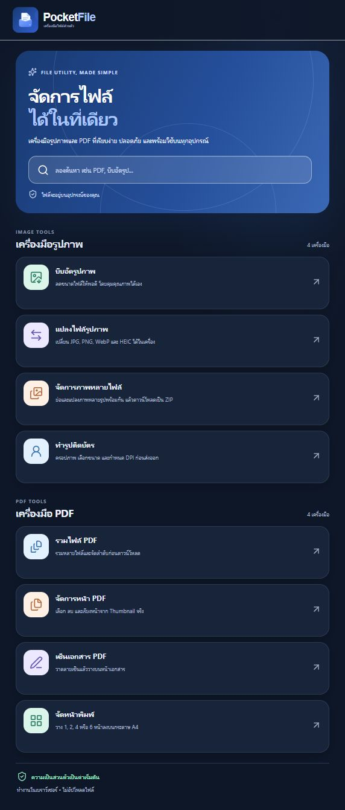
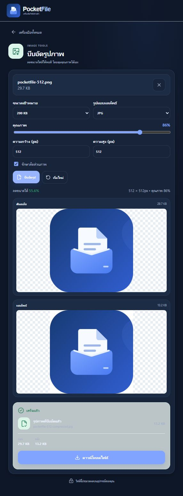

# 📁 PocketFile

PocketFile คือเว็บไซต์เครื่องมือจัดการรูปภาพและ PDF ภาษาไทย รวมงานที่ใช้บ่อยไว้ในที่เดียว เช่น บีบอัดรูป แปลงไฟล์ ทำรูปติดบัตร รวม PDF และวางลายเซ็น

เหมาะสำหรับคนที่ต้องเตรียมรูปหรือเอกสารก่อนส่งงาน พิมพ์ หรือแนบแบบฟอร์ม เลือกเครื่องมือและเริ่มใช้งานผ่านเว็บไซต์ได้ทันที โดยประมวลผลไฟล์บนอุปกรณ์ของคุณ

[🌐 เข้าใช้งานเว็บไซต์](https://title5656.github.io/PocketFile/) · [💻 GitHub](https://github.com/Title5656/PocketFile)

### 🧰 หน้ารวมเครื่องมือ — เลือกงานที่ต้องการทำ

ค้นหาเครื่องมือจากชื่อหรือคำที่เกี่ยวข้อง เช่น บีบอัดรูป, HEIC หรือ PDF แล้วเลือกจากหมวดรูปภาพและ PDF มีรายการเครื่องมือที่ใช้ล่าสุดเพื่อกลับมาเปิดได้สะดวก



### 🖼️ หน้าบีบอัดรูปภาพ — ตั้งค่าและตรวจผลลัพธ์ก่อนดาวน์โหลด

เลือกไฟล์ ตั้งขนาดเป้าหมาย คุณภาพ รูปแบบไฟล์และขนาดภาพ แล้วเปรียบเทียบต้นฉบับกับผลลัพธ์ พร้อมดูขนาดไฟล์ก่อนและหลังบีบอัด ภาพตัวอย่างด้านล่างใช้ไฟล์โลโก้ของโปรเจกต์



## ✨ ฟีเจอร์หลัก

- **บีบอัดรูปภาพ** — กำหนดขนาดไฟล์เป้าหมาย ปรับคุณภาพและขนาดภาพ พร้อมแสดงผลเมื่อบีบอัดไม่ถึงเป้าหมาย
- **แปลงไฟล์รูปภาพ** — แปลงเป็น JPG, PNG หรือ WebP และเปิดไฟล์ HEIC/HEIF ที่ระบบถอดรหัสรองรับได้
- **จัดการภาพหลายไฟล์** — ย่อหรือแปลงภาพเป็นชุด ดาวน์โหลดทีละไฟล์หรือรวมเป็น ZIP พร้อมจัดการชื่อไฟล์ซ้ำ
- **ทำรูปติดบัตร** — เลือกขนาดสำเร็จรูปหรือกำหนดเอง ปรับครอปและซูม พร้อมส่งออก JPG/PNG ตามจำนวนพิกเซลและ DPI ที่เลือก
- **รวมไฟล์ PDF** — เพิ่มหลายไฟล์ จัดลำดับ แล้วรวมเป็นเอกสารเดียว
- **จัดการหน้า PDF** — ดูภาพตัวอย่าง เลือกเก็บหรือลบหน้า ระบุช่วงหน้า และเรียงลำดับก่อนส่งออก
- **เซ็นเอกสาร PDF** — วาดลายเซ็น วางและปรับตำแหน่งบนหน้าเอกสาร แล้วส่งออก PDF ที่ฝังภาพลายเซ็น
- **จัดหน้าพิมพ์** — วาง 1, 2, 4 หรือ 6 หน้าลงบนกระดาษ A4 เลือกแนวกระดาษและระยะขอบ พร้อมดูตัวอย่างไฟล์ที่สร้างแล้ว

เว็บไซต์ใช้ **ภาษาไทยและธีมมืดอย่างเดียว** พร้อมใช้งานบนคอมพิวเตอร์และหน้าจอมือถือ ไม่มีปุ่มตั้งค่าภาษาหรือสลับธีม

## 🚀 วิธีใช้งาน

1. เปิด [PocketFile](https://title5656.github.io/PocketFile/) แล้วเลือกเครื่องมือที่ต้องการ หรือค้นหาจากช่องค้นหา
2. กด **เลือกไฟล์** หรือลากไฟล์มาวางในพื้นที่รับไฟล์ โดยดูรูปแบบที่รองรับในแต่ละเครื่องมือ
3. ปรับค่าตามงาน เช่น ขนาดภาพ รูปแบบไฟล์ ลำดับหน้า หรือตำแหน่งลายเซ็น
4. กดปุ่มประมวลผลของเครื่องมือนั้น แล้วตรวจภาพตัวอย่าง ขนาดไฟล์ หรือจำนวนหน้าในผลลัพธ์
5. กด **ดาวน์โหลดไฟล์** หรือ **ดาวน์โหลด ZIP** เพื่อเก็บผลลัพธ์ไว้ในเครื่อง ก่อนเริ่มงานใหม่หรือออกจากหน้าเครื่องมือ

## 💾 การบันทึกและความเป็นส่วนตัว

- ใช้งานได้โดยไม่ต้องสมัครสมาชิก ไม่มีบัญชี ฐานข้อมูล หรือบริการประมวลผลไฟล์บนเซิร์ฟเวอร์
- รูปภาพและ PDF ประมวลผลในเบราว์เซอร์ ไม่ส่งไฟล์ของคุณขึ้นเซิร์ฟเวอร์เพื่อแก้ไขหรือแปลงไฟล์
- เบราว์เซอร์บันทึกเฉพาะรายการเครื่องมือที่ใช้ล่าสุด ไม่บันทึกไฟล์ต้นฉบับหรือผลลัพธ์ไว้สำหรับเปิดต่อภายหลัง
- ไฟล์ที่ยังไม่ได้ดาวน์โหลดอาจหายเมื่อเริ่มใหม่ ออกจากเครื่องมือ ปิดหน้า หรือรีโหลด ควรดาวน์โหลดและตรวจไฟล์ผลลัพธ์ก่อนเสมอ
- เว็บไซต์และ repository เปิดเป็นสาธารณะ แม้ตั้งใจทำไว้ใช้งานส่วนตัว จึงไม่ใช่พื้นที่เก็บเอกสารที่จำกัดสิทธิ์เข้าถึง
- หลังเปิดออนไลน์ครั้งแรก แอปจะพยายามแคชตัวเว็บไซต์และไฟล์ที่จำเป็นไว้เพื่อใช้งานแบบออฟไลน์ ทั้งนี้ขึ้นอยู่กับการรองรับและพื้นที่จัดเก็บของเบราว์เซอร์ โดยไม่แคชไฟล์ส่วนตัวของคุณ

## 📌 ข้อจำกัดและข้อควรรู้

- **รูปภาพ:** ไม่เกิน 25 MB ต่อไฟล์, 40 ล้านพิกเซล และ 12,000 พิกเซลต่อด้าน
- **ภาพหลายไฟล์:** ไม่เกิน 20 ไฟล์ รวมไฟล์ต้นฉบับไม่เกิน 100 MB และผลลัพธ์รวมไม่เกิน 100 MB
- **PDF:** ไม่เกิน 50 MB ต่อไฟล์และ 150 หน้า การรวม PDF รับได้ไม่เกิน 10 ไฟล์ รวมไม่เกิน 100 MB และผลลัพธ์ไม่เกิน 150 หน้า
- **รูปติดบัตร:** ขนาดกำหนดเองอยู่ระหว่าง 0.2–8 นิ้วต่อด้าน ภายใต้ขีดจำกัดพิกเซลของภาพ ไม่มีฟีเจอร์เปลี่ยนพื้นหลัง และ DPI ในไฟล์ไม่ได้ตั้งค่าขนาดพิมพ์ของเครื่องพิมพ์ให้โดยอัตโนมัติ
- การบีบอัดพยายามลดไฟล์ให้ถึงเป้าหมาย แต่บางภาพอาจยังใหญ่กว่าเป้าหมายหรือมีขนาดเพิ่มขึ้นได้ ควรดูผลลัพธ์จริงก่อนดาวน์โหลด
- HEIC/HEIF บางแบบอาจเปิดไม่ได้ ขึ้นอยู่กับตัวถอดรหัสและเบราว์เซอร์ หากไม่รองรับให้แปลงเป็น JPG ก่อน
- ลายเซ็นเป็น **ภาพที่ฝังลงใน PDF** ไม่ใช่ Digital Signature ที่ยืนยันตัวตนด้วยใบรับรอง การวาดต้องใช้เมาส์ นิ้ว หรืออุปกรณ์ชี้ตำแหน่ง ส่วนภาพลายเซ็นที่วางแล้วขยับด้วยปุ่มลูกศรได้
- PDF ที่มีรหัสผ่าน เสียหาย หรือใช้คุณสมบัติบางชนิดอาจเปิดไม่ได้ การคัดลอกหรือจัดหน้าอาจไม่เก็บแบบฟอร์ม ลิงก์ บุ๊กมาร์ก หรือ annotations ได้ครบ ควรตรวจเอกสารสำคัญหลังส่งออก
- การยกเลิกหยุดงานที่จุดพักถัดไป ขั้นตอนถอดรหัสหรือส่งออกที่เริ่มแล้วอาจทำงานต่อจนจบก่อนปลดล็อกให้เริ่มงานใหม่
- ไฟล์ใหญ่ยังใช้หน่วยความจำของเครื่อง แม้อยู่ในขีดจำกัด ไม่ได้รับรองการทำงานกับทุกไฟล์หรือทุกอุปกรณ์ และยังไม่ได้ทดสอบ Safari/iPhone/Android บนอุปกรณ์จริงอย่างครบถ้วน

<details>
<summary>🛠️ สำหรับผู้พัฒนา — รัน ทดสอบ และ deploy</summary>

โปรเจกต์ใช้ React, TypeScript และ Vite โดยประมวลผลไฟล์ฝั่งเบราว์เซอร์ ใช้ **Node.js 24** และ npm สำหรับพัฒนา

```sh
git clone https://github.com/Title5656/PocketFile.git
cd PocketFile
npm ci
npm run dev
```

เปิด URL ที่ Vite แสดงใน terminal เมื่อต้องการตรวจสอบและสร้างไฟล์ production:

```sh
npm test
npm run typecheck
npm run build
npx playwright install chromium --only-shell
npm run test:e2e
npm audit --audit-level=high
```

- ไฟล์ production อยู่ใน `dist/` และเปิดตรวจได้ด้วย `npm run preview`
- E2E ใช้ Chromium กับ production preview ที่ `http://127.0.0.1:4275/PocketFile/` ทดสอบเลือกไฟล์ ประมวลผล ดาวน์โหลด และเปิดตรวจผลลัพธ์จริง
- โฮสต์ผ่าน GitHub Pages โดยใช้ path **`/PocketFile/`** ซึ่งต้องตรงตัวพิมพ์ใหญ่–เล็ก ตั้งค่า Pages source เป็น **GitHub Actions**
- เมื่อพุชขึ้น `main` workflow จะรัน tests, typecheck, build, dependency audit และ E2E ก่อน deploy โดยใช้ public repository และ runner มาตรฐาน `ubuntu-latest` ไม่ต้องมี backend โดเมนเสียเงิน หรือบริการโฮสต์เพิ่มเติม
- ดูรายละเอียดผลตรวจและข้อจำกัดเพิ่มเติมได้ใน [รายงาน QA](docs/QA-2026-10-24.md) เอกสารออกแบบเก่าบางฉบับอธิบายฟีเจอร์รุ่นก่อนหน้า; README นี้อธิบายการใช้งานปัจจุบัน

</details>

## 🔗 ลิงก์

- [🌐 เข้าใช้งาน PocketFile](https://title5656.github.io/PocketFile/)
- [💻 GitHub Repository](https://github.com/Title5656/PocketFile)
- [💬 แจ้งปัญหาหรือเสนอแนะ](https://github.com/Title5656/PocketFile/issues)
- [✅ ผลการทดสอบและ deployment](https://github.com/Title5656/PocketFile/actions)
